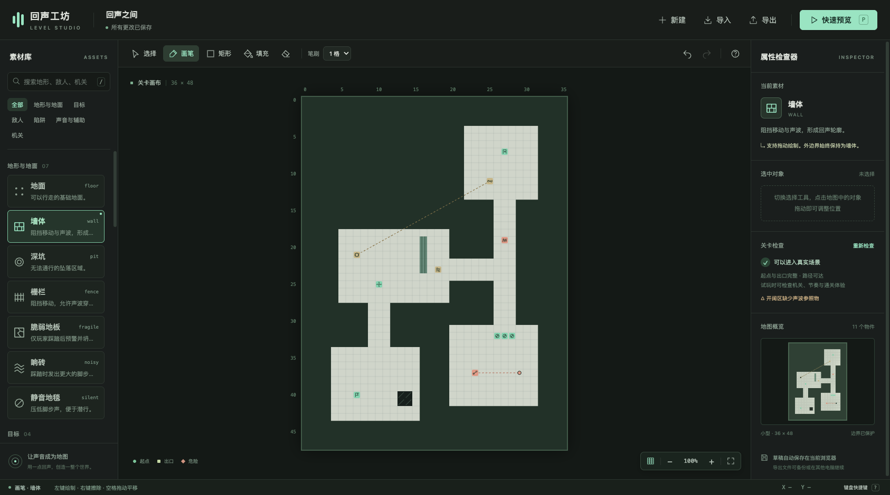

# 回声工坊 · Silent Chamber Workshop

给微信小游戏《寂静密室》制作可玩的声学迷宫。你可以先用种子生成地图，用网页版编辑器画墙、布置声锁和守卫，再走进黑暗里听一遍自己的关卡。



## 打开编辑器

[直接在浏览器打开回声工坊](https://anothorld.github.io/silent-chamber-workshop/)

下载或克隆本仓库，解压后双击 `docs/index.html`。预构建版本包含脚本、样式与现场合成的试听音效，可离线使用。桌面键盘和鼠标操作最方便。若浏览器限制本地文件存储或剪贴板权限，用“下载 JSON”保存作品，或按下方命令运行本机服务。

1. 默认示例「回声之间」已包含起点、声锁、出口、巡逻者和地刺。按 **P** 直接试玩，试着在岔路停下蓄力，让声波照出墙体。按 **Esc** 回到地图。
2. 通过“新建 → 生成迷宫”选择小、中、大三种规格，也可以新建空白地图。用画笔、矩形或连通填充绘制地形，在素材库选择敌人、机关与可交互物件。巡逻路线、声波中继等成对素材要依次点击两个位置。
3. 检查右侧提示，设置起点、出口与所需机关。用 **WASD / 方向键** 移动，按 **Shift** 轻走。站定按住空格、松开探测，用 **E** 朝鼠标方向投掷诱饵。
4. 导出草稿 JSON 可以保留未完成的作品。通过校验后再导出 ECL 游戏关卡码，可以在小游戏工坊手动粘贴并按游戏内流程导入。编辑器将草稿存于当前浏览器，导出文件便于备份和跨设备接力。

网页沿用游戏的草稿格式、碰撞、声波传播、敌人行为和声场渲染。试玩音效由 Web Audio 合成，音色与小游戏有所区别。

## 用种子生成可编辑的关卡

命令行与测试使用 Node.js 20 或以上版本。生成器自身仅依赖 Node.js。下面示例从 Growing Tree 算法和种子 314 生成一张 36 × 48 底图。

```sh
node scripts/generate-draft.js 314 growing-tree my-maze.json
```

在网页点击“导入”，选择文件或粘贴 JSON。草稿带有临时起终点，适合先检查空间再布置机关。算法支持 `dfs`、`prim`（Prim 风格的随机活动节点选择）和 `growing-tree`。算法与种子相同即可复现布局。统计量写入标准错误，省略文件名时 JSON 输出到标准输出。命令只创建新文件。

比较算法时运行 `npm run review:mazes`，再打开 `output/trials/maze-algorithm-trials.html`。它展示 96 张候选底图，可逐个比较岔点、环路、图直径与盲支。网页“新建”使用适配三种尺寸的独立生成器。

## 使用地图生成 Skill

以此仓库作为工作目录，在支持仓库技能的 Codex 会话里调用 `$design-acoustic-levels`。也可手动阅读技能说明，按同一流程设计地图。[技能入口](.agents/skills/design-acoustic-levels/SKILL.md)

> 用 $design-acoustic-levels 做一关「回声岔路」。先对比三个种子，再设计一条靠轻步通过的近路和一条可用声波探测的远路。给我能导入工坊的 JSON、实际试玩记录和地图评审页。

工作流包括筛选种子、编写关卡设计单、按听觉线索布置机关、测试成功和失误的路径，以及交付可复核的地图说明。每个关键元素都要能解释玩家为什么会在这里改变行动。

## 本地开发

在仓库根目录依次安装并启动，打开终端打印的地址，默认为 `http://127.0.0.1:4174`。开发服务在启动时重新构建，修改脚本后重启即可。

```sh
npm ci
npm run dev
```

```sh
npm test
npm run build
```

`scripts/web-editor/` 提供浏览器界面，`src/ugc/` 提供草稿模型、校验与关卡码编解码，`src/solo-levels/maze.js` 生成可复现的迷宫图。发布静态站点时同步提交 `docs/` 的构建产物，GitHub Pages 可以从 main 分支的 /docs 目录提供服务。

代码、工作流与仓库内的示例采用 MIT 许可证。[许可全文](LICENSE)
